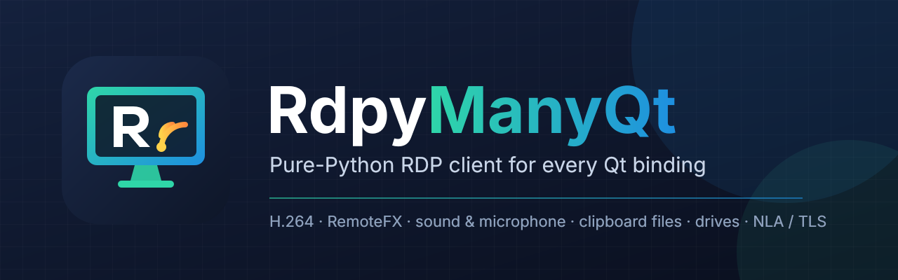
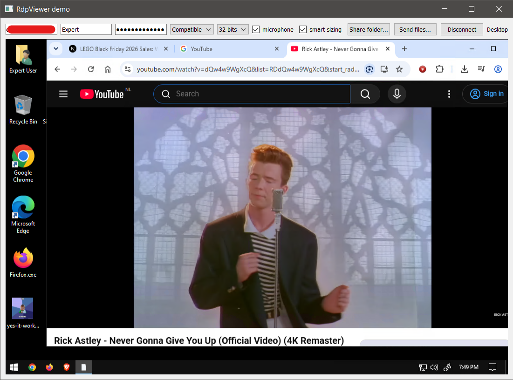

# RdpyManyQt



## Project description

Microsoft RDP client built with Python, [Twisted](https://twisted.org/)
and [ManyQt](https://github.com/Usama01TN/ManyQt).

It is forked from https://github.com/citronneur/rdpy.
While rdpy has various commands, this project only includes the RDP client.

[](https://youtu.be/dQw4w9WgXcQ)

## Installation:

```sh
pip install rdpymanyqt
```

To use the H.264 decoding feature, please install it as follows.

```sh
pip install "rdpymanyqt[h264]"
```

### Smooth video and sound:

Video decoding and audio playback need native code to run in real time:

* Install PyAV (`pip install "rdpyqt[h264]"`); without it the server falls back to much
  slower codecs.
* Build the Cython decoders: run `pip install .` from the project folder (on Windows this
  needs the *Microsoft C++ Build Tools*). At start-up the client logs which decoders are
  compiled and warns about the pure Python ones.
* Sound plays through Qt Multimedia with any binding ManyQt supports (PyQt5, PyQt6,
  PySide2, PySide6). ManyQt prefers PyQt5 when several are installed; set `QT_API=pyqt6`
  to choose another one.

The graphics pipeline is decoded on a worker thread so the window, the network and the
audio stay responsive. Set `RDPY_GFX_THREAD=0` to decode on the network thread instead.

### Building and releasing (all platforms):

`.github/workflows/build-release.yml` builds RdpyManyQt with
[cibuildwheel](https://cibuildwheel.pypa.io) on GitHub Actions:

| Platform                      | Architectures                     | Python                                       |
|-------------------------------|-----------------------------------|----------------------------------------------|
| Windows                       | x86-64, x86 (32-bit), ARM64       | 3.11 - 3.15                                  |
| Linux (manylinux + musllinux) | x86-64, ARM64                     | 3.11 - 3.15                                  |
| macOS (11+)                   | Intel, Apple Silicon              | 3.11 - 3.15                                  |
| iOS                           | device, simulator (ARM64, x86-64) | versions with iOS support (3.13 - 3.15)      |
| Android                       | arm64-v8a, x86-64                 | versions with Android support (3.13 - 3.15)  |

plus a pure-Python wheel (`py3-none-any`, any platform) and the source archive. Every desktop
wheel is installed and checked (`tools/check_wheel.py`) before it is kept. The decoders need
Cython and a C compiler to build, not NumPy (NumPy is only a runtime dependency).

Every push to `main` / `master` (and every tag `v*`, or a manual run of the workflow)
publishes the GitHub release **v&lt;version&gt;** (`version` in `pyproject.toml`) with every
wheel and a `SHA256SUMS.txt`: the tag is force-moved to the built commit and the release
assets are replaced. Bump the version to start a new release instead of updating the current
one. The release is published even if a platform fails (the run is still marked failed and
the release notes say wheels are missing). Pull requests only build. To (re)tag by hand:

```sh
python tools/build.py release      # force-tags v<version> on HEAD and force-pushes the tag
```

The mobile wheels are libraries for app packagers (Briefcase, pyside6-android-deploy);
running the client on a phone also needs Qt and the other dependencies built for it.

32-bit Windows and Windows ARM64: recent cryptography releases (needed by pyOpenSSL) publish
no wheels there, so install with `pip install --only-binary cryptography rdpymanyqt` to get
the last release that has one instead of compiling it (Intel Macs get it automatically).

Local builds: `python tools/build.py wheel | pure | sdist | cibw [android|ios] | check`.

## Usage:

```sh
rdpyqt [options] ip[:port]
```

### Options:

| Option                | Description                                                           | Default            |
|-----------------------|-----------------------------------------------------------------------|--------------------|
| `-u`                  | Username                                                              | (empty)            |
| `-p`                  | Password                                                              | (empty)            |
| `-d`                  | Domain                                                                | (empty)            |
| `-w`                  | Width of screen                                                       | `1280`             |
| `-h`                  | Height of screen                                                      | `1024`             |
| `-kt`                 | Keyboard type (see values below)                                      | `IBM_101_102_KEYS` |
| `-kl`                 | Keyboard layout (see values below)                                    | `US`               |
| `--swap-alt-meta`     | Swap Alt and Meta (Windows/Super/Command) keys                        | (disabled)         |
| `--disable-avc444`    | Disable AVC444/AVC444v2 and use AVC420 only                           | (disabled)         |
| `--drive [NAME=]PATH` | Redirect a local directory to the server as a drive (can be repeated) | (none)             |

#### `-kt` Keyboard Type values:

| Value              | Description                            |
|--------------------|----------------------------------------|
| `IBM_PC_XT_83_KEY` | IBM PC/XT 83-key keyboard              |
| `OLIVETTI`         | Olivetti keyboard                      |
| `IBM_PC_AT_84_KEY` | IBM PC/AT 84-key keyboard              |
| `IBM_101_102_KEYS` | IBM 101/102-key keyboard (most common) |
| `NOKIA_1050`       | Nokia 1050 keyboard                    |
| `NOKIA_9140`       | Nokia 9140 keyboard                    |
| `JAPANESE`         | Japanese keyboard                      |

#### `-kl` Keyboard Layout values:

| Value                 | Language / Region       |
|-----------------------|-------------------------|
| `ARABIC`              | Arabic                  |
| `BULGARIAN`           | Bulgarian               |
| `CHINESE_US_KEYBOARD` | Chinese (US keyboard)   |
| `CZECH`               | Czech                   |
| `DANISH`              | Danish                  |
| `GERMAN`              | German                  |
| `GREEK`               | Greek                   |
| `US`                  | English (United States) |
| `SPANISH`             | Spanish                 |
| `FINNISH`             | Finnish                 |
| `FRENCH`              | French                  |
| `HEBREW`              | Hebrew                  |
| `HUNGARIAN`           | Hungarian               |
| `ICELANDIC`           | Icelandic               |
| `ITALIAN`             | Italian                 |
| `JAPANESE`            | Japanese                |
| `KOREAN`              | Korean                  |
| `DUTCH`               | Dutch                   |
| `NORWEGIAN`           | Norwegian               |

Example:

```sh
rdpyqt -u user -p password -w 1920 -h 1080 rdp_server:3389
```

### Options:

| Option                             | Description                                                                                                                                    | Default  |
|------------------------------------|------------------------------------------------------------------------------------------------------------------------------------------------|----------|
| `--bpp 15\|16\|24\|32`             | Colour depth. The graphics pipeline is 32-bit only, so a lower depth uses legacy bitmap updates                                                | `32`     |
| `--gfx on\|off`                    | Graphics pipeline (H.264, RemoteFX) or legacy bitmap updates                                                                                   | `on`     |
| `--clipboard off\|text\|files`     | Clipboard sharing; `off` does not open the clipboard channel. `--no-clipboard` = `off`                                                         | `files`  |
| `--microphone`                     | Redirect the local microphone to the server (MS-RDPEAI, PCM)                                                                                   | off      |
| `--no-sound`                       | Do not play the remote sound                                                                                                                   | sound on |
| `--audio-latency MS`               | Smallest audio buffer                                                                                                                          | `60`     |
| `--share DIR[=NAME]`               | Same as `--drive NAME=DIR`                                                                                                                     |          |
| `--size WIDTHxHEIGHT`              | Same as `-w` / `-h`                                                                                                                            |          |
| `--connect-timeout MS`             | Give up when the connection (TCP connect and RDP connection sequence) is not established in time                                               | `15000`  |
| `--timeout MS`                     | Drop a connection whose data is not acknowledged in time (FreeRDP `/timeout`); TCP keep-alive (5 s, every 2 s, 3 probes) detects a dead server | `9000`   |
| `--shell COMMAND`, `--workdir DIR` | Start a program instead of the desktop (the server policy must allow it)                                                                       |          |

### Security:

The protocols the client offers follow FreeRDP's `rdpSettings` flags (`NlaSecurity`,
`TlsSecurity`, `RdpSecurity`, `IgnoreCertificate`). The strongest enabled protocol is tried
first; when the server refuses it the next enabled one is tried (FreeRDP `nego.c`).

| Option                      | FreeRDP equivalent             | Effect                                                    |
|-----------------------------|--------------------------------|-----------------------------------------------------------|
| `--sec nla\|tls\|rdp`       | `/sec:`                        | Offer only this protocol                                  |
| `--sec-nla on\|off`         | `NlaSecurity`                  | Network Level Authentication (needs user + password)      |
| `--sec-tls on\|off`         | `TlsSecurity`                  | TLS transport security                                    |
| `--sec-rdp on\|off`         | `RdpSecurity`                  | Legacy RDP security layer (experimental)                  |
| `--cert ignore\|tofu\|deny` | `/cert:` / `IgnoreCertificate` | Server certificate check, default `tofu`                  |
| `--security max`            |                                | NLA + TLS only, no RDP security, strict certificate check |
| `--security compat`         |                                | Every protocol, self-signed certificates accepted         |

Certificate modes: `deny` accepts only a certificate chained to a trusted authority (the
system store, Windows included) and issued to the host name. `tofu` accepts those too;
otherwise it remembers the first certificate seen for `host:port` in
`~/.config/rdpymanyqt/known_hosts` (`%APPDATA%\rdpymanyqt\known_hosts` on Windows) and refuses a
different one later (possible man-in-the-middle). The check runs during the TLS handshake,
before any credential is sent. When a certificate is refused, the disconnect dialog shows its
fingerprint with a **Trust this certificate** button. `ignore` accepts anything.

### Embedding: RdpViewerWidget and Qt Designer:

`rdpy.ui.rdpviewer.RdpViewerWidget` is a self-contained widget for your own applications.
Every RdpyManyQt feature is a Qt property (editable in Designer), a constructor keyword and a
getter / slot setter:

| Group      | Properties                                                                                                                                                                  |
|------------|-----------------------------------------------------------------------------------------------------------------------------------------------------------------------------|
| Connection | `host`, `port`, `username`, `password`, `domain`, `clientName`, `desktopWidth`, `desktopHeight`, `connectTimeout`, `ackTimeout`, `autoConnect`, `shell`, `workingDirectory` |
| Display    | `colorDepth` (*ColorDepth*), `graphicsPipeline`, `avc444`                                                                                                                   |
| Devices    | `clipboardMode` (*ClipboardMode*), `soundEnabled`, `microphoneEnabled`, `audioLatency`, `drives` (`'NAME=PATH'` list; also `addDrive()`, `removeDrive()`, `clearDrives()`)  |
| Keyboard   | `keyboardLayout` (*KeyboardLayout*), `keyboardType` (*KeyboardType*), `swapAltMeta`                                                                                         |
| Security   | `nlaSecurity`, `tlsSecurity`, `rdpSecurity`, `certificateMode` (*CertificateMode*), `securityPreset` (*SecurityPreset*)                                                     |

Enumerations are nested `IntEnum`s registered with Qt: `State`, `ColorDepth` (Bpp15...Bpp32),
`ClipboardMode` (Off, Text, Files), `CertificateMode` (Ignore, Tofu, Deny), `SecurityPreset`
(Custom, Default, Maximum, Compatible), `KeyboardLayout` (US, FRENCH, GERMAN... Windows layout
ids), `KeyboardType`, `TransferDirection` (Upload, Download), `TransferStatus` (Completed,
Partial, Cancelled). Setters also accept the int value or the name (`colorDepth=16`,
`clipboardMode='files'`).

Methods: `connectToHost()`, `disconnectFromHost()`, `getState()`, `isConnected()`,
`isLoggedOn()`, `getSessionReport()`, `getSessionInfo()`, `saveScreenshot(path)`,
`sendFiles(paths)`, `getCertificateRejection()`, `trustCertificate()`, `getLastError()`.

Signals: `connected`, `disconnected(reason)`, `connectionFailed(reason)`, `stateChanged(State)`,
`loginScreenReached`, `desktopReached`, `logonFailed(message)`, and the file transfer signals
below.

```python
from rdpy.ui.rdpviewer import RdpViewerWidget, ensureQtReactor
ensureQtReactor()                    # before anything imports twisted.internet.reactor
viewer = RdpViewerWidget(host='server', username='user', password='secret',
                         certificateMode='tofu', connected=lambda: print('connected'))
viewer.connectToHost()
```

Demo: `python -m rdpy.ui.rdpviewer.main`. For **Qt Designer**, set `PYQTDESIGNERPATH` to the
installed `rdpy/ui/rdpviewer` folder (it contains `rdpviewerplugin.py`) and start Designer with
the Python plugin loader (pyqt5-tools / pyqt6-tools): the widget appears in the *RdpyManyQt*
group. Logo and banner are in `branding/` (SVG, PNG, ICO).

### Logon events:

The client tells apart the two stages of a connection, from what the server sends
(MS-RDPBCGR Save Session Info, as FreeRDP's `SaveSessionInfo` callback):

| Event        | When                                                                                      | rdpyqt option           | Qt signal (QRemoteDesktop / RdpViewerWidget) | Observer callback                   |
|--------------|-------------------------------------------------------------------------------------------|-------------------------|----------------------------------------------|-------------------------------------|
| Login screen | the first picture is shown before the user is logged on (Windows logon or welcome screen) | `--on-login-screen CMD` | `loginScreenReached`                         | `onLoginScreen()`                   |
| Desktop      | the server notifies that the user is logged on and the desktop starts                     | `--on-desktop CMD`      | `desktopReached`                             | `onDesktopReady()`                  |
| Logon error  | the server reports a logon error or warning (bad password, password must change...)       | `--on-logon-error CMD`  | `logonError(str)` / `logonFailed(str)`       | `onLogonError(type, data, message)` |

Commands run without blocking the client, with `RDP_EVENT`, `RDP_HOST`, `RDP_PORT`, `RDP_USER`
and `RDP_LOGON_MESSAGE` in their environment. `RdpViewerWidget.getState()` also reports
`loginScreen` and `desktop`. With autologon the desktop event may come without a login screen
event; servers that never send logon notifications (xrdp) only produce the login screen event.

```sh
rdpyqt -u user -p password --on-desktop "notify-send 'RDP desktop ready'" server
```

### File transfer events:

Copies through the clipboard and files the server reads or writes on a shared drive are
reported (direction *upload* = local files going to the server, *download* = files received):

| Event                            | Observer callback                                          | Qt signal (QRemoteDesktop / RdpViewerWidget) | rdpyqt hook               |
|----------------------------------|------------------------------------------------------------|----------------------------------------------|---------------------------|
| Clipboard transfer started       | `onFileTransferStarted(direction, items, totalBytes)`      | `fileTransferStarted`                        | `--on-transfer-start CMD` |
| Clipboard transfer progress      | `onFileTransferProgress(direction, doneBytes, totalBytes)` | `fileTransferProgress`                       |                           |
| Clipboard transfer finished      | `onFileTransferFinished(direction, paths, bytes, status)`  | `fileTransferFinished`                       | `--on-transfer-done CMD`  |
| Shared-drive file read / written | `onDriveFileTransferred(direction, path, bytes)`           | `driveFileTransferred`                       | `--on-transfer-done CMD`  |

`status` is *completed*, *partial* (the paste stopped before the end) or *cancelled*. Uploads
finish when the server has read every byte of the pasted files; downloads when every file is
saved locally (the paths of the local copies are given). Hooks receive `RDP_TRANSFER_KIND`
(clipboard / drive), `RDP_TRANSFER_DIRECTION`, `RDP_TRANSFER_ITEMS`, `RDP_TRANSFER_BYTES`,
`RDP_TRANSFER_PATHS` (separated by the system path separator) and `RDP_TRANSFER_STATUS`. In
RdpViewerWidget, direction and status are `TransferDirection` / `TransferStatus` values.

### Smart sizing:

The remote desktop is always centred in the widget. Without smart sizing it is shown 1:1 (black
margins when the widget is larger than the remote resolution; in `rdpyqt` resizing the window
reconnects with the new size, which then fills it).

By default, resizing the window reconnects with the new size (the remote resolution follows
the window). With **smart sizing** (as mstsc's *Smart sizing* and FreeRDP's `/smart-sizing`)
the remote desktop keeps its resolution and is scaled to cover the whole window instead (no
black bars, as mstsc and FreeRDP), with no reconnection; the mouse is mapped back to remote
coordinates. `--keep-aspect` / *Keep aspect ratio* letterboxes with black bars instead.

- `rdpyqt --smart-sizing ...` (`--keep-aspect` for black bars); switch it at any time with
  Shift + right-click > *Smart sizing* / *Keep aspect ratio (black bars)*.
- RdpViewerWidget: `smartSizing` and `keepAspectRatio` properties (the remote resolution is
  `desktopWidth` x `desktopHeight`, or the widget size when connecting).
- QRemoteDesktop: `setSmartSizing(enabled, keepAspectRatio)`, `toRemote(x, y)`.

What smart sizing covers: scaled painting with smooth filtering (partial repaints identical to a
full repaint, no seams), black letterbox bars, mouse moves / clicks / wheel mapped to remote
coordinates (clamped at the edges), the remote pointer scaled with its hot spot like FreeRDP,
resolution changes decided by the server (Demand Active, RDPGFX ResetGraphics) followed
without reconnecting, window resize / maximize / full screen without reconnecting, HiDPI
displays, switching on and off at any time (a window goes back to 1:1; an embedded widget
adopts its layout size and the session follows), and screenshots at the full remote resolution.

### Logging:

The library logs warnings and errors only, so applications embedding RdpViewerWidget keep a
quiet terminal; `rdpyqt` shows INFO messages. Set `RDPY_LOG_LEVEL=DEBUG` (or `INFO`, `ERROR`,
`NONE`) in the environment, or call `rdpy.core.log.set_level()`, to change it.

### Disconnecting:

Closing the window disconnects like FreeRDP's `freerdp_disconnect`: input stops, the local audio
devices, decoder and drive threads are released, the Disconnect Provider Ultimatum (reason
*user requested*) is sent and the client waits for the server to close its side (forcing the
socket closed after 2 s at most), then exits. A protocol error ends the session at once with the
cause in the disconnect dialog; an error inside a virtual channel (clipboard, sound, drives...)
only drops that message.

Every way of ending the client disconnects the same clean way (tested against FreeRDP's
server, which then logs *ERRINFO_LOGOFF_BY_USER*, as for its own client):

| How it ends                                          | What happens                                                                       |
|------------------------------------------------------|------------------------------------------------------------------------------------|
| Window closed                                        | disconnect, then exit (no "session ended" dialog)                                  |
| Ctrl+C, SIGTERM, SIGHUP, Ctrl+Break                  | the same, exit code 128 + signal                                                   |
| `QApplication.quit()` / computer logout or shutdown  | `aboutToQuit` disconnects every open session (2.5 s max) before exit               |
| Window holding an `RdpViewerWidget` closed           | the close waits for the disconnect (3 s max), then completes                       |
| `RdpViewerWidget` deleted, or `disconnectFromHost()` | the session is closed; `disconnected('closed by the user')`, never an error signal |

Applications embedding the client call `rdpy.ui.qt.installCleanExit(app)` after starting the
reactor to get the same behaviour (RdpViewerWidget installs the `aboutToQuit` part itself).
As with mstsc and FreeRDP, disconnecting leaves the Windows session *disconnected* (the user
stays signed in, ready to reconnect); sign out from the Start menu, or set the server's time
limit for disconnected sessions, to end it.

### Session report, screenshot:

`--info` and `--screenshot FILE` run in the console only (no window): the client connects,
waits for the first picture plus `--wait SECONDS` (default 3), then prints the report and/or
saves the screen, and exits. `--json` prints the report as JSON. Exit codes: 0 ok,
1 bad arguments, 2 connection failed, 3 screenshot failed.

```sh
rdpyqt -u user -p password --info rdp_server
rdpyqt -u user -p password --screenshot desk.png --info --json rdp_server
```

The report shows what the client received while connecting, without any extra connection:
the remote computer (Windows version and build, NetBIOS/DNS names, server clock - from the
NTLM challenge when the server uses NLA), the logged-on user and session id, the security
protocol and RDP version, the features in use and the server certificate (subject, issuer,
validity, SHA-256/SHA-1 fingerprints, key, alternative names).

In the window, **Shift + right-click** opens the client menu (a plain right-click goes to the
remote machine): *Session info...*, *Screenshot...* and *Send files to the remote clipboard...*.
Files dropped on the window also go on the remote clipboard (paste with Ctrl+V). When the
session ends without being closed from the window, a dialog shows the server's reason with
**Reconnect** and **Close**.

### Clipboard:

Text and files are shared in both directions through the clipboard ([MS-RDPECLIP]):

* Copy files or folders in your local file manager and paste them in the remote session
  (Explorer shows its usual progress dialog).
* Copy files or folders in the remote session and press Ctrl+V locally once the console
  shows `clipboard: ... received`. They are downloaded into a temporary folder that is
  removed when the client exits, so paste them where you want to keep them. Downloads
  larger than 4096 MB are refused; set `RDPY_CLIPBOARD_MAX_MB` to change the limit.

### Drive redirection:

The `rdpdr` device redirection channel ([MS-RDPEFS]) is supported for drives.
Each `--drive` option shares a local directory with the remote session, where it
appears in Explorer as *NAME on HOSTNAME* (`\\tsclient\NAME`).
When `NAME` is omitted the directory name is used.

```sh
rdpyqt -u user -p password --drive docs=~/Documents --drive /mnt/usb rdp_server
```

The server cannot reach anything outside the shared directories: `..` components are
rejected, symbolic links and junctions that lead outside of a share are hidden and
denied, and the share root itself cannot be deleted or renamed. Byte-range locks are
enforced between the handles of the session; a conflicting lock request fails at once
instead of waiting. A drive whose directory is no longer available when reconnecting
is skipped with a warning.

Printer, serial/parallel port and smart card redirection are not implemented.

### Project lineage and credits:

**RdpyManyQt** by [UsamaTN](https://github.com/Usama01TN) is a fork of
[rdpyqt](https://github.com/nakagami/rdpyqt) by [Hajime Nakagami](https://github.com/nakagami), itself based on
[rdpy](https://github.com/citronneur/rdpy) by [Sylvain Peyrefitte](https://github.com/citronneur), licensed
[GPL-3.0-or-later](LICENSE).
It is not an official rdpyqt release. See [CHANGELOG.md](CHANGELOG.md) for the changes and [NOTICE](NOTICE) for credits
(including the FreeRDP logic it follows).

### Support:

If RdpyManyQt is helpful and useful to you, a star on GitHub would mean a lot and helps others discover them. If you'd
like to support development further:

<p>
  <a href="https://ba9chich.com/fr/IninouUsama"></a>
  <a href="https://ko-fi.com/usamatn"></a>
</p>

- **Ba9chich (Leave a tip):** [ba9chich.com/fr/IninouUsama](https://ba9chich.com/fr/IninouUsama)
- **Ko-fi (Buy me a coffee for extra energy):** [ko-fi.com/usamatn](https://ko-fi.com/usamatn)

Thank you so much <3 :)
